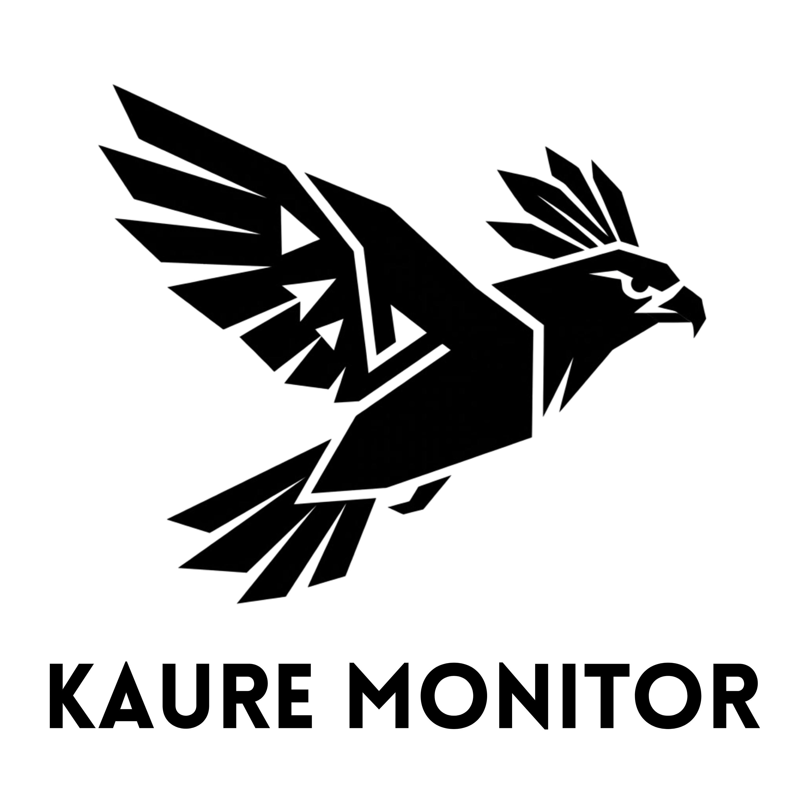

# Kaure AI Monitor


# kaure-monitor

> Local observability for AI agent usage — no cloud, no external collection.

kaure-monitor captures telemetry from every AI agent running on your machine (Claude Code, Cursor, Aider, Cline, Codex, direct APIs and local models) and presents actionable statistics to help you optimize cost, latency and context engineering.

---

## Why

Developers working with multiple AI agents have no unified view of:

- How much they're spending per session / day / week (USD and BRL)
- Which agent or model delivers the best cost-benefit ratio
- Where context is being wasted (redundant tokens, cache misses)
- Latency patterns per model and task type

## How it works

Two local Rust binaries share a SQLite database:

- **`kaure-daemon`** — starts at OS login, runs silently in the background (~5 MB RAM), watches AI agent logs and persists everything locally
- **`kaure-app`** — Tauri dashboard you open when you want to see the data; WebView is freed when the window closes

No data leaves your machine.

---

## Status

> 🚧 Early development — Phase 0 (foundation)

| Phase | Description | Status |
|-------|-------------|--------|
| 0 | Repo scaffold, CI, architecture skeleton | 🔨 In progress |
| 1 | Core domain + SQLite persistence | ⏳ Pending |
| 2 | Claude Code JSONL collector (MVP) | ⏳ Pending |
| 3 | Basic Tauri dashboard | ⏳ Pending |
| 4 | Statistics engine | ⏳ Pending |
| 5 | Additional collectors (HTTP proxy, Cursor, Aider) | ⏳ Pending |
| 6 | Export & integrations | ⏳ Pending |

---

## Stack

| Layer | Technology |
|-------|-----------|
| Daemon / Core | Rust (cargo workspace) |
| UI Shell | Tauri v2 |
| Frontend | TypeScript + React + Recharts |
| Local database | SQLite via `sqlx` |
| Async runtime | Tokio |

---

## Quick Start

```bash
# Coming in Phase 2
```

---

## Architecture

See [docs/ARCHITECTURE.md](docs/ARCHITECTURE.md) for the full hexagonal layer breakdown.

All architectural decisions are recorded in [docs/adr/](docs/adr/).

## License

MIT